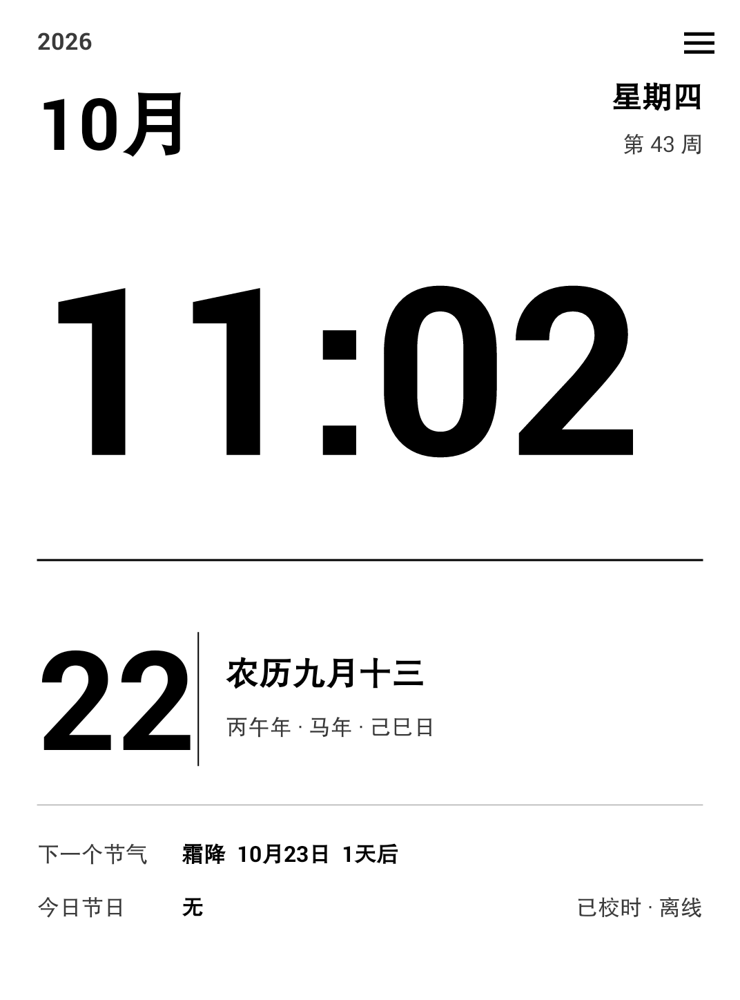
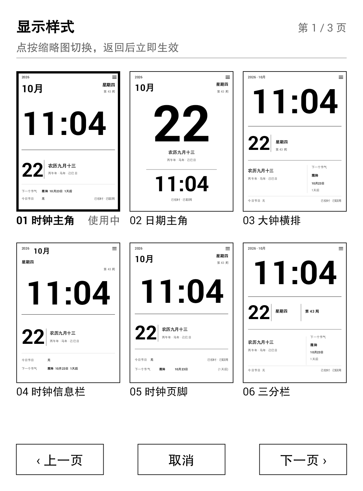
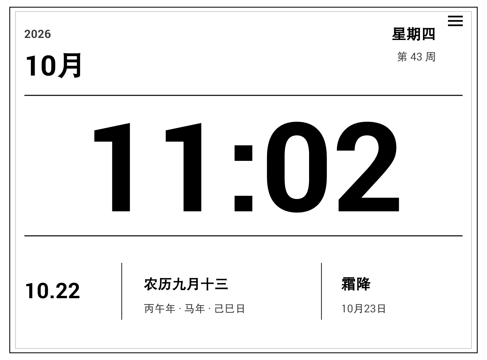
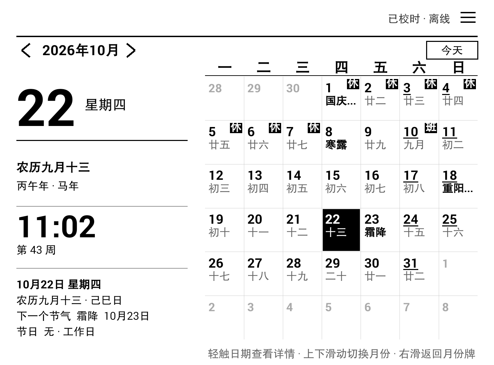
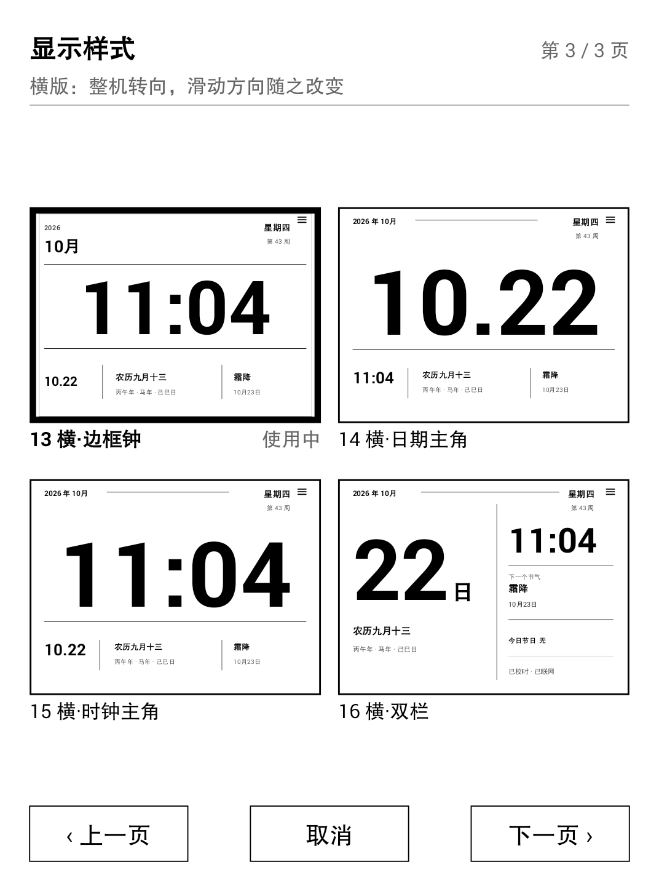

# 日历看板 (E-ink Calendar)

一个为墨水屏阅读器（京东 JDRead / Onyx 代工，Android 4.4.2 / API 19）定制的
**联网日历看板**：电子钟 + 公历日期 + 农历 + 干支 + 节气 + 节日 + 法定节假日/调休。

## 界面截图

| 月份牌（竖版 01） | 月历页（竖版） | 显示样式选择（竖版，第 1/3 页） |
| :---: | :---: | :---: |
|  |  |  |

| 月份牌（横版 13） | 月历页（横版） | 显示样式选择（横版，第 3/3 页） |
| :---: | :---: | :---: |
|  |  |  |

> 截图由 debug 构建的 `DebugShot` 直接把 View 渲染成 PNG，绕开墨水屏面板，
> 因此没有残影，也不受整机转向影响（横版即 1448×1072）。生成方式见
> `app/src/main/java/com/zbl/einkcalendar/DebugShot.java` 的类注释。

## 功能

- **两页上下滑动**：默认是「月份牌」大字页，任一竖向滑动切到月历页，再竖向滑动（或按返回键）回到月份牌。
- **16 套月份牌版式可选**：内置 12 套**竖版**（时钟主角 / 日期主角 / 大钟横排 / 时钟信息栏 /
  时钟页脚 / 三分栏 / 中号时钟 / 一周条 / 居中日期 / 左右双栏 / 三栏页脚 / 明细清单）
  与 4 套**横版**（横·边框钟 / 横·日期主角 / 横·时钟主角 / 横·双栏）。
  在月份牌页**滑动即可循环切换版式**（竖版左右滑、横版上下滑），也可以走
  设置 →「显示样式」进入独立的**缩略图选择页**（3 页：6 + 6 套竖版、4 套横版），
  缩略图是真实渲染缩小、横版按横版比例显示，点一下即生效并返回。
  选择结果存在 SharedPreferences（`poster_style`）。
- **横版会旋转整个界面**：选中横版版式时 Activity 切到横屏，`DashboardView` 重新按
  1448×1072 排版，**月历页也变成横版**（左侧信息栏 + 右侧月历网格），
  **滑动手势的轴也跟着转**——横向滑动翻页、纵向滑动换版式。
- **月份牌页（无黑条、编辑式排版）**：默认版式为「时钟主角」——左上角年份，
  右上角星期与 ISO 周数；下方左对齐的月份大字、分隔线、超大字电子钟；
  底部为大号日期 + 农历/干支，再往下是节气/节日信息行。
  所有版式共用同一套数据、同样的纯黑白与留白原则。
- **统一的排版规则（16 套版式全部遵守）**：
  - **所有日期与时间一律粗体**（年、月、日、星期、周数、电子钟、节气日期、农历）；
  - 正文最小 **32px**（1072px 宽基准，横版以 1072px 高为基准），次要信息不再使用小字；
  - 次要文字统一 `#3A3A3A` 深灰、细线 `#8F8F8F`，不使用浅灰；
  - 每套版式按「页边距 5%、块间距 ≥ 字号的 0.25 倍」单独排布，
    大字、细线、竖分隔线之间保证不重叠，纵向节奏逐套校准；
  - 每套版式都按整页高度重新分配纵向空间：首行距顶 3–5%、末行距底 6–9%，
    中间各块间距尽量均匀，避免底部大片留白或几条内容挤在一起。
- **电子钟**：大号 HH:mm，每分钟刷新一次（避免秒级重绘在墨水屏上产生残影）。
- **日期信息**：公历日期、星期、农历（含闰月）、干支年/日、生肖、周数。
- **月历网格**：周一起始，6×7 固定网格；今天黑底白字反色，选中项描边，
  周末日期数字加下划线；越界日期淡显。
- **传统信息**：每日农历日/月、二十四节气（含交节时刻）、传统节日
  （春节/元宵/清明/端午/七夕/中秋/重阳/腊八/小年/除夕）与公历节日
  （元旦/情人节/妇女节/植树节/愚人节/劳动节/儿童节/建军节/教师节/国庆节/
  平安夜/圣诞节/母亲节/父亲节/感恩节）。
- **法定节假日**：从 `timor.tech` 拉取当年「休/班」数据，网格内显示 **休**/**班**
  角标；离线时回退到内置节日，并继续使用上次缓存。
- **网络校时**：读取 HTTP 响应的 `Date` 头计算本机时钟偏差（不改系统时间），
  启动时与每 6 小时校一次；断网时自动回退到本机时间。
- **底部详情**：选中日期的完整信息 + 未来 3 个节气/节日倒计时。

## 墨水屏设计约定

- 纯黑白：背景 `#FFFFFF`，正文 `#000000`；仅网格线 `#CFCFCF`、次要文字
  `#666666`、越界日期 `#AAAAAA` 使用中性灰。
- 无动画、无渐变、无阴影；状态变化用整屏重绘。
- 常亮显示（可在设置中关闭），启动后全屏、隐藏状态栏与导航栏。

### 常亮与休眠

- 只设置 `FLAG_KEEP_SCREEN_ON` 在本机不够：系统仍按「设置 → 显示 → 休眠」
  （最长 30 分钟）计时并切到待机界面。
- 因此同时持有 `SCREEN_BRIGHT_WAKE_LOCK`（带 `ACQUIRE_CAUSES_WAKEUP`），
  并在收到 `ACTION_SCREEN_OFF` 后自动重新点亮（1 分钟内最多 3 次，防止死循环）。
- 开关关闭或 App 退到后台（`onPause`）时立即释放唤醒锁，系统恢复正常休眠；
  缩略图选择页同样适用该规则。

## 屏幕刷新（残影处理）

**为什么会有残留**：这块屏是 i.MX EPDC 驱动，驱动自己决定每次更新用
「局部刷新（DU）」还是「全屏刷新（GC16）」。DU 速度快但会把上一帧的深色
像素留成浅灰残影；只有 GC16 才会把残影彻底擦掉。

**能做到的**：App 层拿不到 GC16 的控制权——

| 途径 | 结果 |
| --- | --- |
| `/sys/class/graphics/fb0/mode` 等 sysfs 节点 | 权限 `root:root`，非 root 不可写 |
| `framework.jar` 内的 `EpdController` / 厂商 Binder 服务 | 不存在 |
| 系统 App（JDRead 是 `priv-app`）的刷新接口 | 未对外开放，普通 App 无法调用 |

**所以采用「整屏反相闪屏」诱导全屏更新**：先铺满一帧黑色、再铺满一帧白色，
最后才绘制内容（约 360ms）。整屏 100% 变化在多数 EPDC 上会触发 GC16，
这也是墨水屏阅读器翻页时那一下闪烁的原理。

刷新时机：

| 时机 | 行为 |
| --- | --- |
| 上下翻页（月份牌 ⇄ 月历） | 整屏刷新 |
| 切换月份（`‹` `›`、网格左右滑） | 整屏刷新 |
| 点选日期 / 回到今天 | 整屏刷新 |
| 每分钟走时 | 只重绘时钟区域（按当前版式自动定位时钟带） |
| 每 30 分钟 | 自动整屏刷新一次 |
| 从后台回到前台 | 整屏刷新 |
| 设置 →「立即全屏刷新」 | 手动整屏刷新 |
| 设置 →「翻页时整屏刷新」 | 可关闭翻页时的闪屏 |

> 说明：本机驱动实测始终走 DU（连续 40 帧黑白交替也不会触发 GC16），
> 因此保存很久的老残影仍可能擦不掉；彻底清除需要 root 后直接写 EPDC 节点，
> 或用厂商阅读器的刷新入口。App 能做的是把每次更新的面积放到最大。

## 操作

| 操作 | 效果 |
| --- | --- |
| 竖版：竖向滑动 / 横版：横向滑动 | 月份牌 ⇄ 月历 切换 |
| 竖版：左右滑动 / 横版：上下滑动（月份牌页） | 上一套 / 下一套版式（循环 01→16→01，自动保存并自动转向） |
| 点按月份牌底部空白 | 进入月历 |
| 点击月历底部提示 | 返回月份牌 |
| 返回键 | 月历 → 月份牌（在月份牌时退出） |
| 点击日期格 | 选中该日期，底部显示详情 |
| 点击 `‹` / `›` | 上/下一个月 |
| 网格内滑动（竖版左右 / 横版上下） | 切换月份 |
| 点击「今天」 | 回到今天 |
| 点击右上角 `☰` | 打开设置 |
| 设置 →「显示样式」 | 进入缩略图页，点选 16 种版式之一（第 3 页为横版） |
| 缩略图页「下一页 / 上一页」 | 翻页（6 + 6 竖版 / 4 横版） |
| 设置中 | 屏幕常亮 / 翻页整屏刷新开关 / 显示样式 / 立即校时 / 更新节假日数据 / 立即全屏刷新 |

> 墨水屏上不做滑动动画：手势判定后直接整屏切换，避免逐帧重绘产生残影。

## 数据来源

| 内容 | 来源 | 离线可用 |
| --- | --- | --- |
| 农历 / 干支 / 生肖 | 内置查表（1888–2100） | 是 |
| 二十四节气 | 内置太阳视黄经迭代算法 | 是 |
| 传统/公历节日 | 内置规则 | 是 |
| 法定节假日、调休 | `https://timor.tech/api/holiday/year/{year}` | 缓存（SharedPreferences，按年） |
| 时间校准 | HTTP `Date` 响应头（默认 `www.baidu.com`，备选 taobao/qq） | 缓存偏差 |

农历与节气结果已与香港天文台 2026 年公历-农历对照表核对一致
（例：2026-10-19 = 九月初十，重阳节为 10-18；寒露 10-08、霜降 10-23）。

## 构建

```powershell
$env:JAVA_HOME = 'C:\Program Files\Android\Android Studio\jbr'
$env:ANDROID_HOME = 'D:\SDK\Android\Sdk'
./gradlew assembleDebug      # 或用缓存的 gradle-8.14
```

- AGP 8.13.1 / Gradle 8.14，`compileSdk 36`、`minSdk 19`、`targetSdk 28`，Java 1.8。
- 无 AndroidX、无第三方依赖（用 `org.json`、`HttpURLConnection`）。
- 注意：工程路径含非 ASCII 字符，`gradle.properties` 中已设
  `android.overridePathCheck=true`。

产物：`app/build/outputs/apk/debug/app-debug.apk`

## 安装

```powershell
adb install -r app/build/outputs/apk/debug/app-debug.apk
adb shell am start -n com.zbl.einkcalendar/.MainActivity
```

## 代码结构

```
app/src/main/java/com/zbl/einkcalendar/
  LunarCalendar.java   农历转换、干支、节气（太阳黄经迭代）、节日规则
  LunarData.java       1888–2100 农历数据表（自动生成）
  MonthModel.java      月历 42 格模型（周一起始、标签优先级）
  DashboardView.java   自绘看板（月历页竖版/横版、手势、刷新控制）
  PosterRenderer.java  月份牌 16 种版式（12 竖 + 4 横）绘制，按比例缩放供缩略图复用
  StylePickerView.java 显示样式选择页（3 页缩略图：竖版网格 + 横版宽图）
  StylePickerActivity.java 显示样式选择入口，保存 poster_style
  HolidayStore.java    节假日拉取/解析/按年缓存（含 API 19 TLS 1.2 补丁）
  TimeSync.java        HTTP Date 校时与偏差持久化
  MainActivity.java    生命周期、分钟 ticker、网络广播、设置对话框
  DebugShot.java       debug 构建的截图导出（View → PNG），运行时无副作用
tools/
  LunarSolarConverter.java  农历表来源（参考，不打包）
  LunarTest*.java           算法自测
```

## 许可

本项目采用 **MIT License**（宽松开源许可），详见 [LICENSE](LICENSE)。

- 允许自由使用、复制、修改、合并、发布、分发、再许可和销售，
  只需保留版权声明与许可声明。
- 软件按「原样」提供，不含任何明示或暗示的担保。
- 仓库中引用的第三方服务（`timor.tech` 节假日接口）与系统字体遵循其各自条款。

